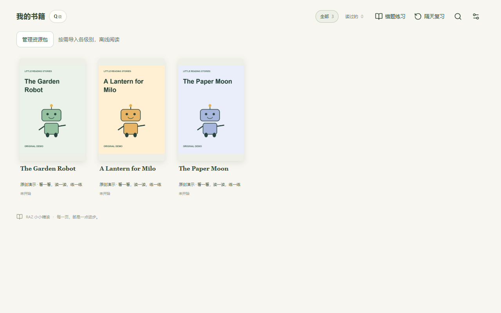
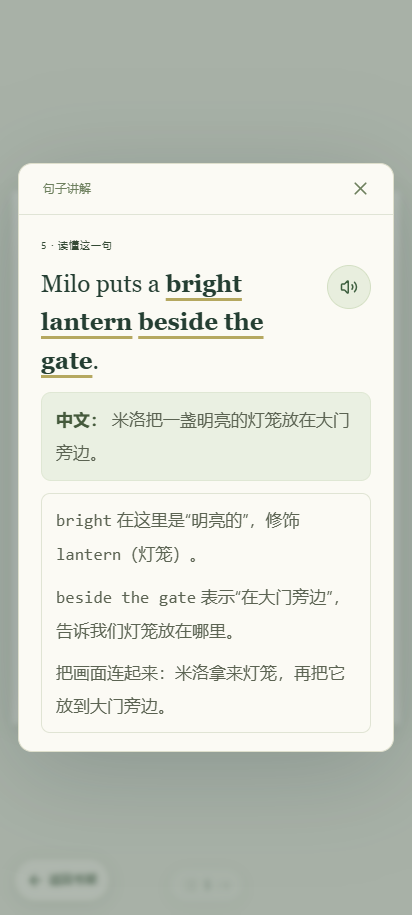
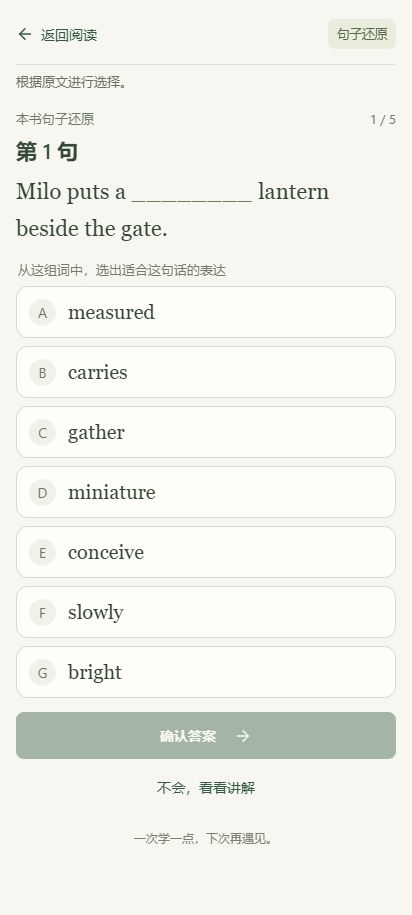

# RAZ Study Reader · 小小精读

[简体中文](README.md) | **English**

RAZ Study Reader is an English reading companion for children and parents. Children can read a book at their own pace, tap an unfamiliar sentence for a Chinese translation and explanation, and listen to its audio when available. After reading, they can practice expressions from the text and revisit mistakes in later review sessions.

The reader runs on Android phones and tablets, and in a desktop web browser. Learning records stay on the device. No account is required, and there are no ads. The current interface and lesson explanations are in Chinese; this English README introduces the project to international readers.

> The application does not include RAZ books or recordings. To begin reading, users must supply a compatible `.razpack` resource pack that they have the right to use. The availability of explanations, audio, and exercises depends on the contents of the imported pack. This repository does not provide RAZ resource packs for download.

## Screenshots

These screenshots show the running application with **original demonstration content created for this project, not RAZ materials**. The Chinese interface labels are explained below.

**Bookshelf: choose a book and resume where you left off.**

**Reading view: read the page, then tap a sentence when you need help.**

<table>
  <tr>
    <th>Tap a sentence for an explanation and its speaker button for audio</th>
    <th>Practice expressions in their original sentences</th>
  </tr>
  <tr>
    <td></td>
    <td></td>
  </tr>
</table>

## Getting started

The current version is **1.0.0** and is being prepared for release. No public APK download or hosted demo is available yet.

### 1. Install or open the reader

- **Android phone or tablet:** Once you have an APK, open it on your device to install the reader. Android 7.0 or later is required; compatibility with individual devices still needs testing.
- **Desktop browser:** Open the URL of a deployed reader in a recent version of Chrome or Edge. You can also run the web application locally; see [Development and builds](docs/development.md) (in Chinese).

### 2. Import your resource pack

From the bookshelf, choose **管理资源包 (Manage resource packs) → 导入资源包 (Import resource pack)**, select a `.razpack` file for the level you want to read, and wait for validation to finish. There is no need to unzip the file. Ordinary PDF or MP3 files cannot be imported directly as resource packs.

You can import just the level you currently need and add other levels later. To update a level, import the new version of its pack. See [Resource packs](docs/resource-packs.md) (in Chinese) for details. Importing a file does not grant permission to use or distribute its contents.

### 3. Read, listen, and practice

1. Choose a book on the bookshelf. In the reading view, tap the page number at the bottom to jump to another page.
2. Tap a sentence that has an explanation to see its translation and notes. A speaker button appears in the explanation when audio is available.
3. Open **读后练习 (After-reading practice)** from the page menu to complete sentences using expressions from the text. You can open the explanation for help or revisit it after answering.
4. Return to the bookshelf for **错题练习 (Mistake review)** and **隔天复习 (Review on later days)**. These sections show relevant content when practice or review is available.

### 4. Back up your learning records

Your reading position is saved automatically on the device. Open **阅读设置 (Reading settings)** on the bookshelf and choose **导出学习记录 (Export learning records)** to save a backup. On a new device, import the same resource packs first, then choose **导入学习记录 (Import learning records)**.

Learning record backups do not contain books. Keep your resource packs and record backups separately. Uninstalling the application or clearing application or website data removes locally stored content and records.

## Frequently asked questions

**Why is the bookshelf empty when I first open the reader?**

The reader and reading materials are separate. The application starts with an empty bookshelf. This repository does not distribute RAZ books or resource packs; users must supply resources they have the right to use.

**Can I use it offline?**

On Android, imported packs support offline reading, playback of included audio, and practice. The web application must first finish caching its application files for offline use. Continue using the same browser and website address. The resource pack management page shows the offline readiness status.

**Does progress sync automatically between devices?**

No. Each device stores its own resources and progress. You can move learning records by exporting and importing them. Changing browsers or website addresses does not automatically transfer your data either.

**Are children's learning records uploaded?**

The reader does not require an account and does not automatically upload reading or exercise records. The web version loads application files when first visited. See the [Privacy notice](docs/privacy.md) (in Chinese) for details.

## Project and licensing

This is an independent community project. It is not affiliated with or endorsed by Learning A–Z, and it is not an official Learning A–Z product. The repository excludes RAZ books, recordings, and lessons or exercises that quote those materials. The software license does not grant rights to reproduce, adapt, or distribute Learning A–Z content. Any proposed distribution of such content would require separate permission from the relevant rights holders.

The original application code is available under the [PolyForm Noncommercial License 1.0.0](LICENSE). Permitted uses are governed by the license text; commercial use outside its permitted purposes requires separate authorization. This is **source-available software under a noncommercial license**, rather than open-source software as defined by the Open Source Initiative. Third-party components retain their own licenses. See the [Code and content rights notice](NOTICE.md) for details.

To run, deploy, or contribute to the reader, see [Development and builds](docs/development.md). For Android installation and signing details, see [Android builds](docs/android-release.md). These technical guides are currently in Chinese.
